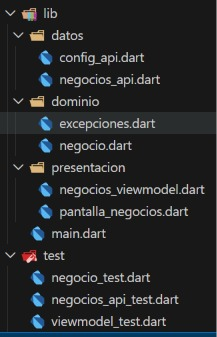
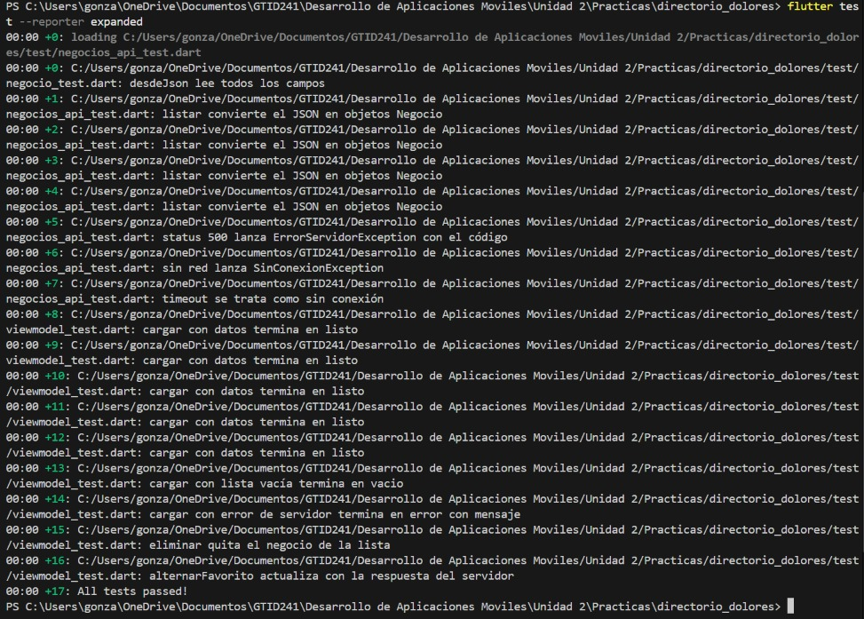
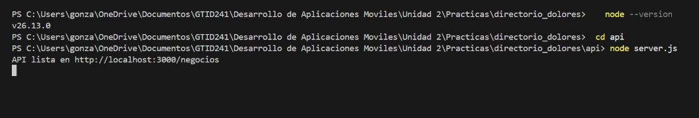
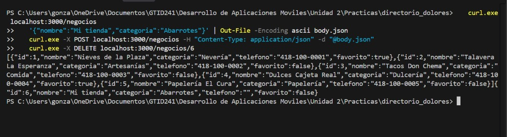
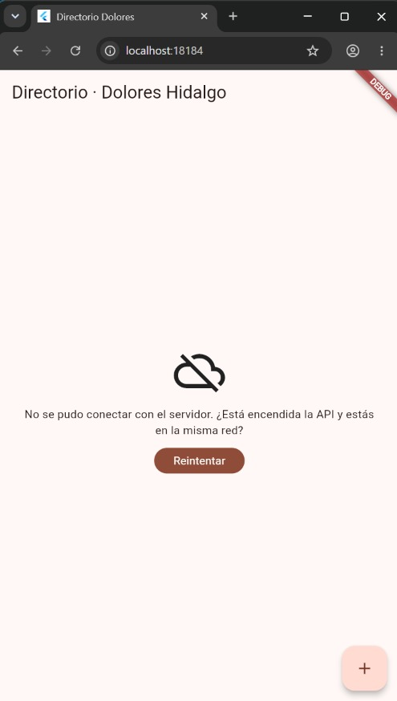

# Directorio Dolorense · Consumo de API local con Flutter y TDD

**Materia:** Desarrollo de Aplicaciones Móviles
**Alumno:** González López Yael Isaac
**Fecha:** 6 de noviembre de 2026

## Descripción

Directorio de negocios de Dolores Hidalgo. Una API REST hecha en Node (corriendo en la computadora) guarda los negocios, y la app Flutter los consulta (GET), agrega (POST), marca como favoritos (PUT) y elimina (DELETE). El cliente HTTP y el ViewModel se desarrollaron con TDD usando MockClient, así que las pruebas no dependen de red ni de servidor. La pantalla maneja los cinco estados: inicial, cargando, listo, vacío y error.

## Estructura del proyecto

## Pruebas de casos (éxito y fallo)

## Pruebas del modelo (4) · test/negocio_test.dart

### Prueba 1: desdeJson lee todos los campos

**Éxito:**

**Fallo:**

### Prueba 2: campos opcionales ausentes usan valores por omisión

**Éxito:**

**Fallo:**

### Prueba 3: aJson no manda id cuando es nuevo

**Éxito:**

**Fallo:**

### Prueba 4: copiarCon cambia solo el favorito

**Éxito:**

**Fallo:**

## Pruebas del cliente HTTP (8) · test/negocios_api_test.dart

### Prueba 5: listar convierte el JSON en objetos Negocio

**Éxito:**

**Fallo:**

### Prueba 6: status 500 lanza ErrorServidorException con el código

**Éxito:**

**Fallo:**

### Prueba 7: sin red lanza SinConexionException

**Éxito:**

**Fallo:**

### Prueba 8: timeout se trata como sin conexión

**Éxito:**

**Fallo:**

### Prueba 9: JSON roto lanza RespuestaInvalidaException

**Éxito:**

**Fallo:**

### Prueba 10: listar con búsqueda manda el parámetro q codificado

**Éxito:**

**Fallo:**

### Prueba 11: crear envía JSON con Content-Type correcto

**Éxito:**

**Fallo:**

### Prueba 12: eliminar usa DELETE al id correcto

**Éxito:**

**Fallo:**

## Pruebas del ViewModel (5) · test/viewmodel_test.dart

### Prueba 13: cargar con datos termina en listo

**Éxito:**

**Fallo:**

### Prueba 14: cargar con lista vacía termina en vacio

**Éxito:**

**Fallo:**

### Prueba 15: cargar con error de servidor termina en error con mensaje

**Éxito:**

**Fallo:**

### Prueba 16: eliminar quita el negocio de la lista

**Éxito:**

**Fallo:**

### Prueba 17: alternarFavorito actualiza con la respuesta del servidor

**Éxito:**

**Fallo:**

## Todas las pruebas en verde (17)

## Evidencia de la aplicación

### API corriendo con node server.js

### Peticiones registradas en la terminal del servidor

### Sin conexión (servidor apagado) con botón Reintentar

