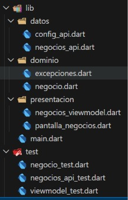
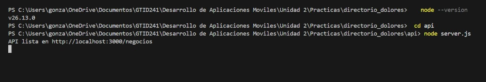
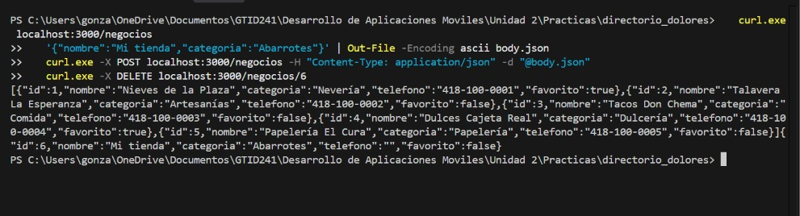
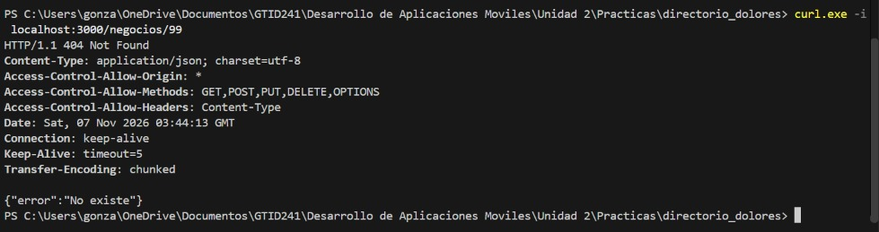
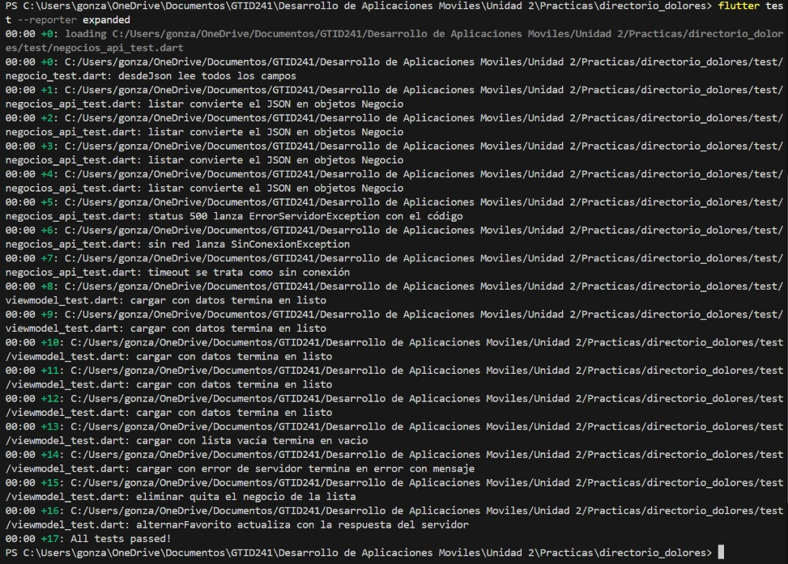
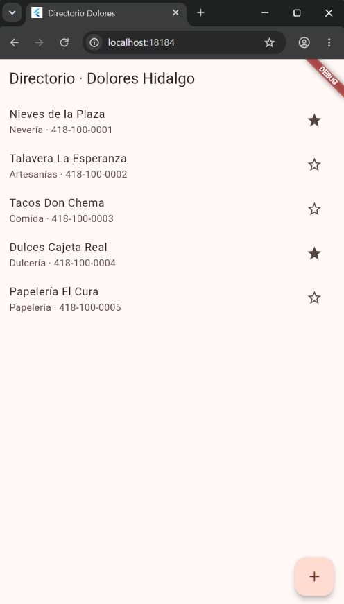
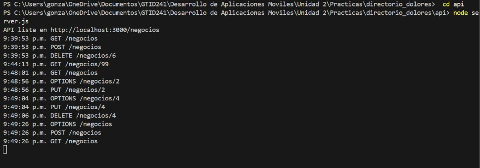
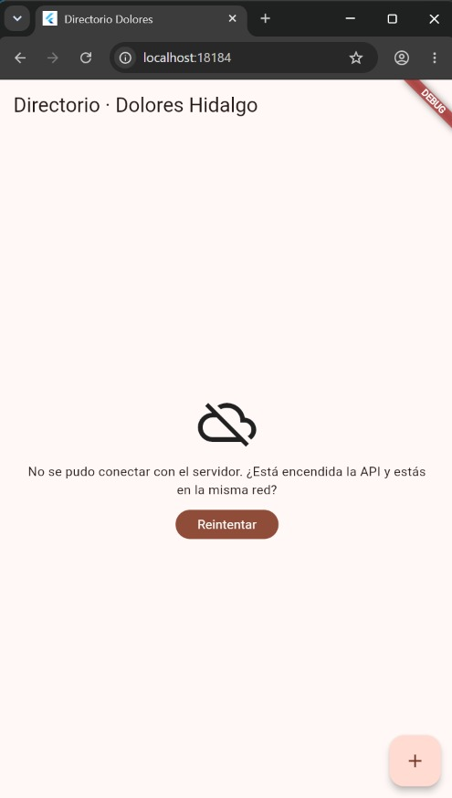
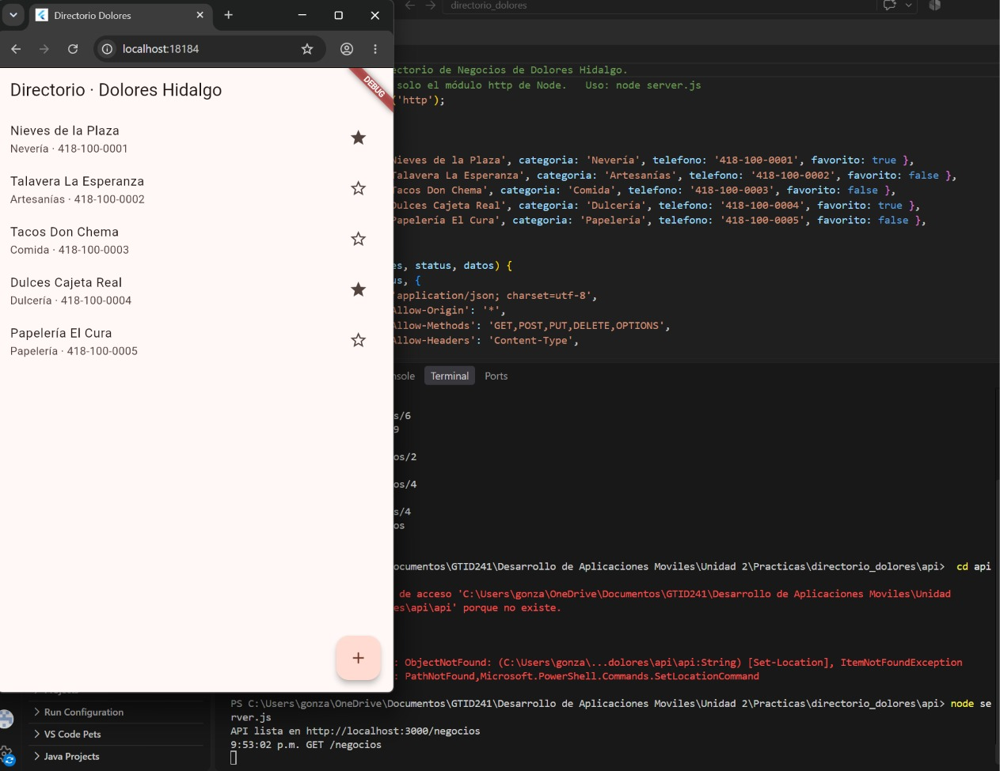

# Directorio Dolorense · Flutter + API local en Node (TDD)

**Materia:** Desarrollo Móvil Integral
**Universidad:** UTNG, Dolores Hidalgo
**Alumno:** González López Yael Isaac
**Fecha:** 6 de Noviembre de 2026

## Descripción

Directorio de negocios de Dolores Hidalgo. Una API REST en Node (un solo archivo, sin dependencias) guarda los negocios; la app Flutter los consulta, agrega, marca como favoritos y elimina. El cliente HTTP se probó con `MockClient` (sin red ni servidor) y la pantalla cubre los 5 estados: inicial, cargando, listo, vacío y error.

## Estructura del proyecto

## Evidencia de la API

### API encendida

### Peticiones con curl: lista, crear y borrar

### Códigos de error: GET /negocios/99 (404) y POST sin categoría (400)

### Todas las pruebas en verde (17)

## Evidencia de la aplicación

### Lista de negocios (estado listo)

### Favorito, agregar y eliminar, con la terminal de la API mostrando las peticiones

### Sin servidor: mensaje de error y botón Reintentar

### Servidor encendido de nuevo: la lista regresa
